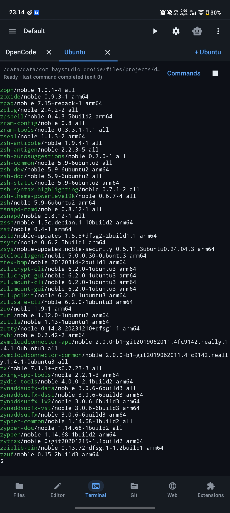

# Droide

Droide is an Android code editor and development workspace by **BayStudio**.
It combines an editor, interactive Linux terminal, Git, build tools, an integrated
browser and optional AI agents on phones and tablets.

This branch contains the complete **1.01 (45) F-Droid candidate source**. It is
prepared for packaging review; it is not an announcement of F-Droid acceptance.
The application code comes from the latest device-tested development source.

## Features

- Multi-tab editing, recovery drafts, search, syntax highlighting and on-demand language servers.
- Ubuntu terminal, SSH, PTY applications, Run/Build, debugger and Git integration.
- Optional built-in and external AI agents, MCP servers, skills and media tools.
- Project import/export and adaptive portrait/landscape workspaces.

## Install and build

Android 10 or newer is required. Ubuntu requires an ARM64 process. First use offers
**Install environment** or **Not now**; the approximately 30 MB Canonical download
requires explicit consent. Completed installations and user packages are reused.
Editing remains available when setup is postponed.

See [F-Droid build instructions](docs/distribution/fdroid.md) for the supported
JDK, Gradle, Android SDK/NDK and exact build command. This source distribution
does not contain prebuilt runtime libraries, a root filesystem, compilers, private
keys or Gradle wrapper binaries. Use `tools/build_fdroid_candidate.py`; the regular
binary-backed release instructions in historical documents do not apply here.

The [packaging recipe](tools/fdroid/com.baystudio.droide.yml) targets the immutable
`v1.01-fdroid` tag. Native engines and compatibility libraries are compiled from
their corresponding source. Dependencies remain locked and checksum-verified.
Release builds run lint and APK, JNI, native, asset and alignment verification.

## Distribution and privacy

AI services and external executables are optional. Providers may require accounts,
API keys or payment. Downloaded tools bypass F-Droid's review; installation requires
approval. Proprietary service integrations and third-party marks are disclosed in
the packaging metadata and [legal notices](app/src/main/assets/legal/THIRD_PARTY_NOTICES.md).

Test APKs use a development certificate and are not production updates. APKs signed
with different keys cannot update each other. F-Droid signing and acceptance remain
subject to the packaging review.

## Project

- [Website](https://droide.rekacipta.biz.id)
- [Issue tracker](https://github.com/baystudio-dev/Droide-v1.-00/issues)
- [F-Droid packaging request](https://gitlab.com/fdroid/rfp/-/work_items/4776)
- [License](LICENSE) and [third-party scope](LICENSE_SCOPE.md)

Droide-owned application code is LGPL-3.0-only. Dependencies retain their respective
licenses. Corresponding sources, provenance and license texts are included.
