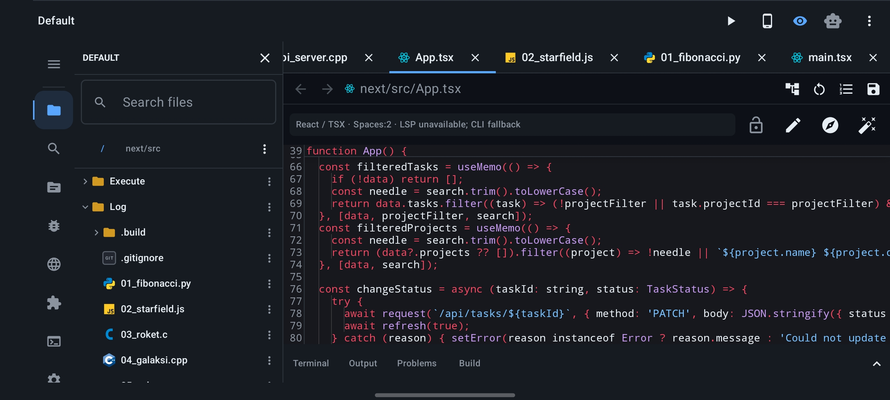
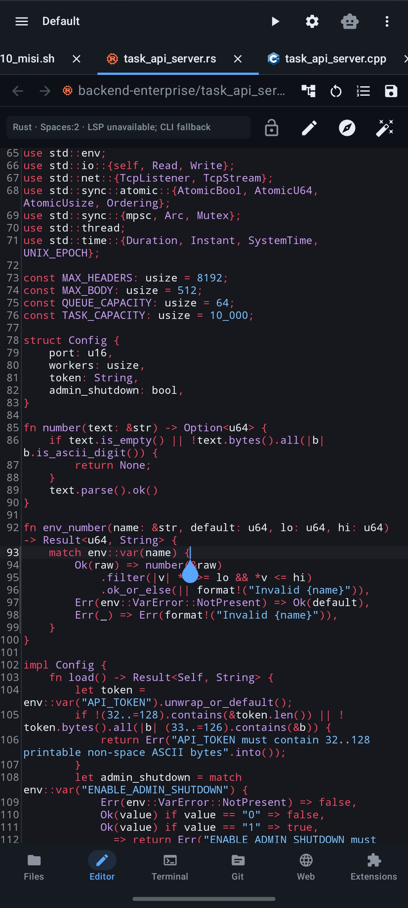
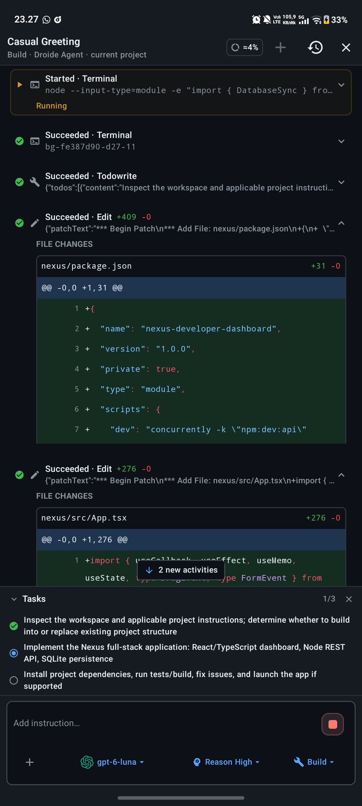
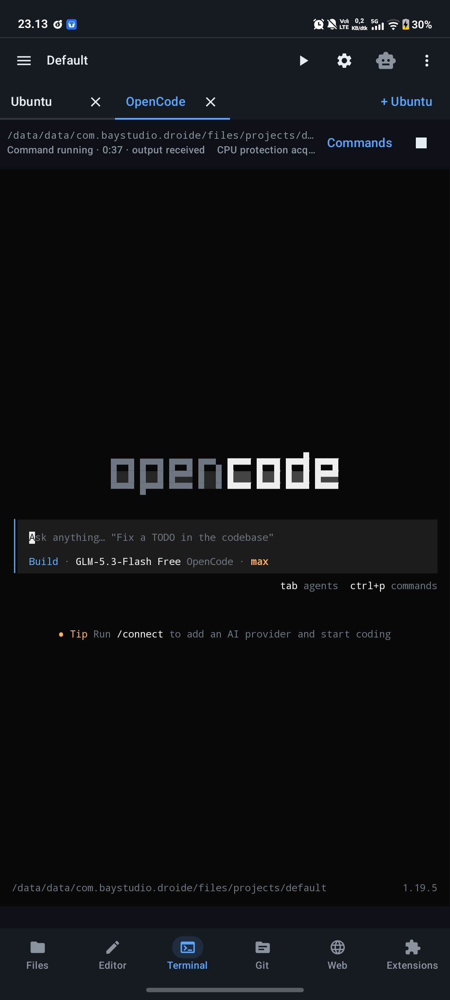
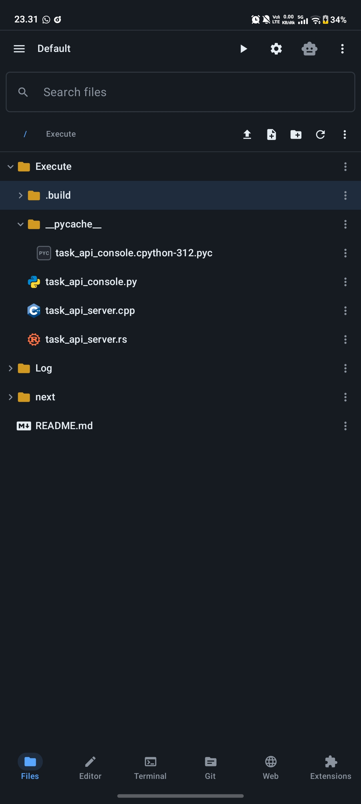
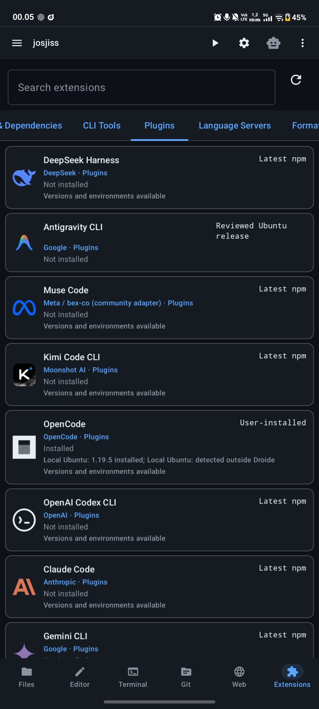
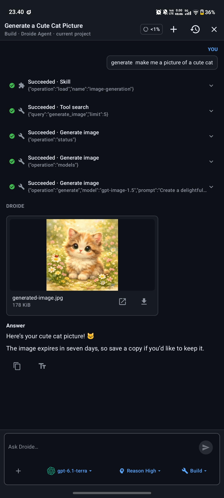

# Droide

  

**Code, run, and build on Android.** Droide is a native development environment by **BayStudio**, bringing a code editor, project files, a Linux terminal, Git, browser previews, and AI agents into one workspace.

[Download v1.00](https://github.com/baystudio-dev/Droide-v1.-00/releases/tag/v1.00) · [Release notes](docs/releases/1.00.md) · [Build from source](docs/BUILDING.md) · [Report a bug](https://github.com/baystudio-dev/Droide-v1.-00/issues)

## Get started

1. Download **Droide-1.00-release.apk** from [the v1.00 release](https://github.com/baystudio-dev/Droide-v1.-00/releases/tag/v1.00) and install it on **Android 10 or newer**.
2. Open or create a project, then use **Files**, **Editor**, **Terminal**, **Git**, **Web**, and **Extensions** to work on it.
3. Install the runtimes and development tools your project needs through **Extensions**. Configure a provider or external agent when you want AI assistance.

The signed APK is approximately **39.8 MiB**. Development toolchains and external agent packages are installed separately. AI services may require a provider account, credentials, and a network connection.

## Capabilities

| Workspace | What you can do |
| --- | --- |
| Editor | Work across tabs with syntax highlighting, language services, completion, diagnostics, navigation, formatting, and recovery drafts. |
| Projects | Search, move, import, and export files and folders. |
| Terminal | Use a persistent Linux workstation and install development tools on demand. |
| AI agents | Follow tool activity, review code changes, connect MCP services, and use reusable skills and browser actions. |
| Development | Build, run, debug, manage Git changes, and preview web projects. |
| Adaptive workbench | Work in portrait or use the landscape editor with collapsible side panels on phones and tablets. |

Language services and tool availability depend on the installed extensions and runtimes.

## Screenshots

Original Android screenshots supplied by the project maintainer. Select an image to view it at full resolution.

<table>
  <tr>
    <th>Code editor</th>
    <th>Agent activity and diffs</th>
    <th>Terminal</th>
  </tr>
  <tr>
    <td></td>
    <td></td>
    <td></td>
  </tr>
  <tr>
    <th>Project files</th>
    <th>Extensions</th>
    <th>Image generation</th>
  </tr>
  <tr>
    <td></td>
    <td></td>
    <td></td>
  </tr>
</table>

## Build and test

Start with [the build guide](docs/BUILDING.md). It specifies the supported toolchain, source build commands, and signing configuration. Signing keys and credentials must remain outside the repository.

Use [the testing guide](docs/TESTING.md) for repository checks, dependency verification, application tests, and device validation. The maintainer has tested v1.00 on Android and reported stable operation. Automated verification results are recorded in [the release notes](docs/releases/1.00.md).

## Repository layout

| Path | Purpose |
| --- | --- |
| `app/` | Android application, packaged resources, and application tests |
| `backend/` | Optional authentication service |
| `resources/` | Brand artwork, original screenshots, and provenance |
| `third_party/` | Required upstream source, licensed assets, and pinned component provenance |
| `tools/` | Build, release verification, and repository maintenance tools |
| `docs/` | Architecture, development, testing, and distribution guides |
| `.github/` | CI workflows and contribution templates |

## Documentation

- [Architecture](docs/ARCHITECTURE.md)
- [Development](docs/DEVELOPMENT.md)
- [Build and signing](docs/BUILDING.md)
- [Testing](docs/TESTING.md)
- [Dependency maintenance](docs/DEPENDENCIES.md)
- [Release process](docs/RELEASING.md)
- [F-Droid packaging readiness](docs/FDROID.md) (submission pending)
- [v1.00 release notes](docs/releases/1.00.md)
- [Contributing](CONTRIBUTING.md)
- [Security reporting](SECURITY.md)

## License

Droide-owned code is licensed under **LGPL-3.0-only**. See [LICENSE](LICENSE), [COPYING](COPYING), [COPYING.LESSER](COPYING.LESSER), and [LICENSE_SCOPE.md](LICENSE_SCOPE.md). Third-party components retain their own licenses and attribution requirements. Distribution obligations are documented in [RELEASE_AND_COMPLIANCE.md](RELEASE_AND_COMPLIANCE.md).
